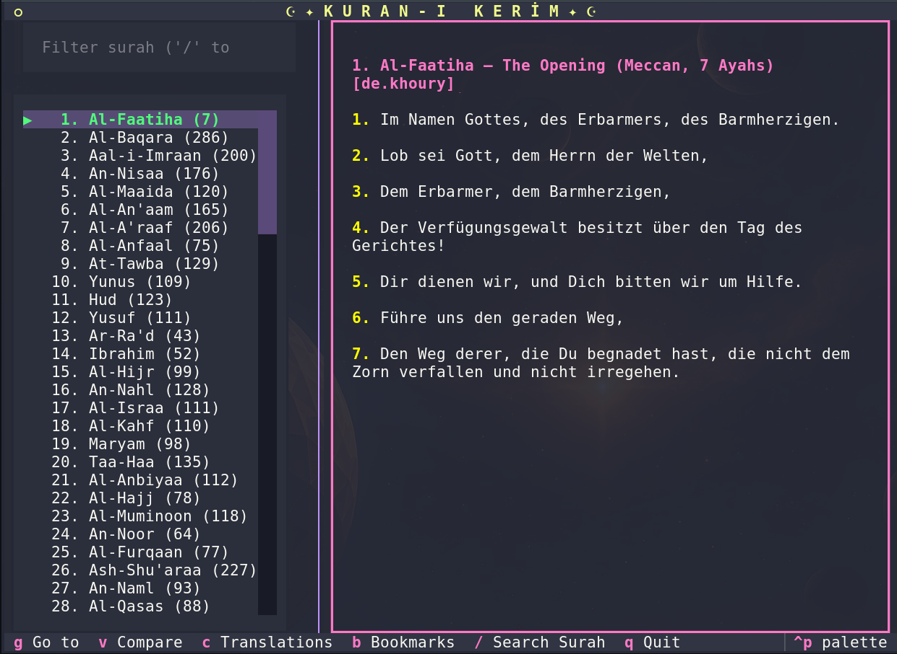
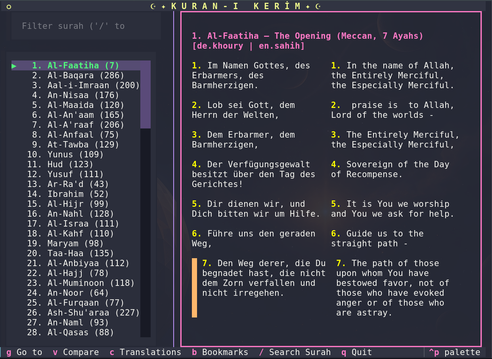
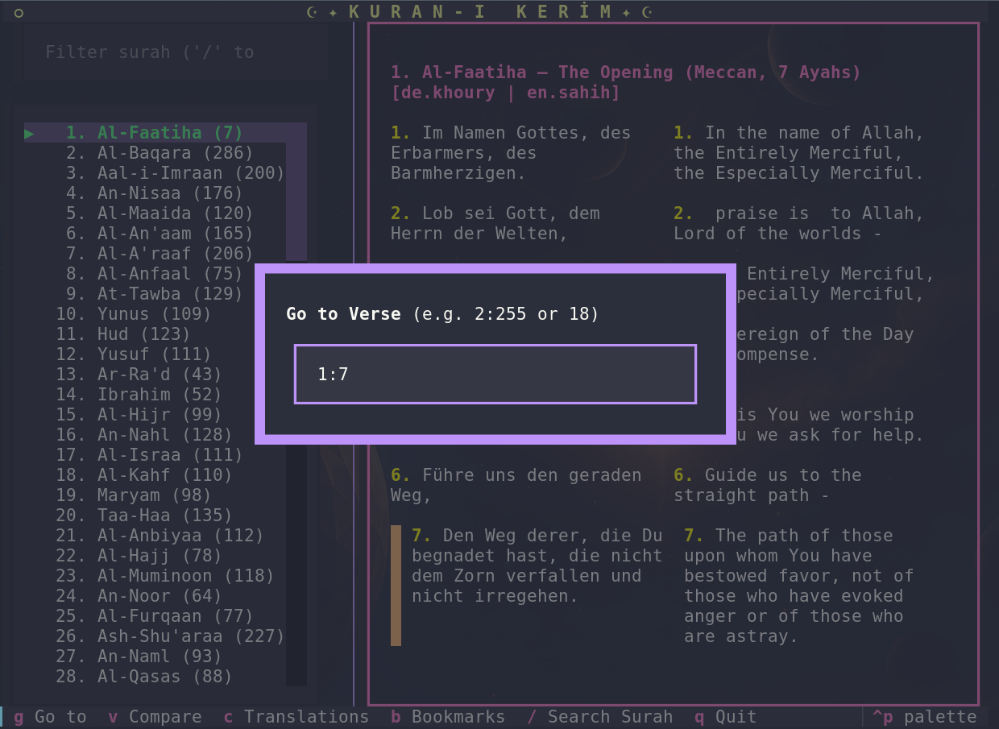

# ☪ Kuran-ı Kerim TUI







A terminal user interface (TUI) for reading the Holy Quran, built with [Textual](https://textualize.io) and the **Dracula** theme.

## ✨ Key Features

- **Parallel Study View (`v`):** Compare two translations side-by-side verse by verse.
- **100+ Translations (`c`):** Access editions in 40+ languages via the [Al Quran Cloud API](https://alquran.cloud).
- **Direct Navigation (`g` / `/`):** Jump to specific verses (e.g., `2:255`) or filter the 114 Surahs.
- **Bookmarks & Cache (`b`):** Save favorites, auto-resume reading, and cache chapters locally in `~/.config/quran-tui/cache/` for offline access.

## 📦 Installation

```bash
pipx install git+https://github.com/postsonde/quran-tui/
```

## 🚀 Usage

```bash
quran
```

### Shortcuts

| Key | Action |
| :--- | :--- |
| `v` | Toggle side-by-side comparison |
| `c` | Select translations |
| `g` | Go to Surah or verse |
| `b` | Bookmarks |
| `/` | Filter Surahs |
| `j` / `k` | Scroll down / up |
| `q` | Quit |

## 📄 License

GPLv3
