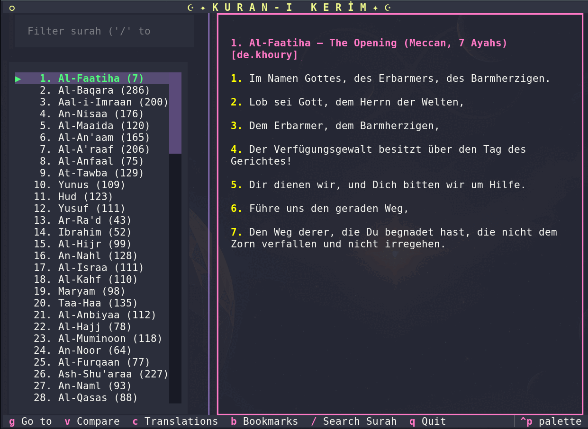
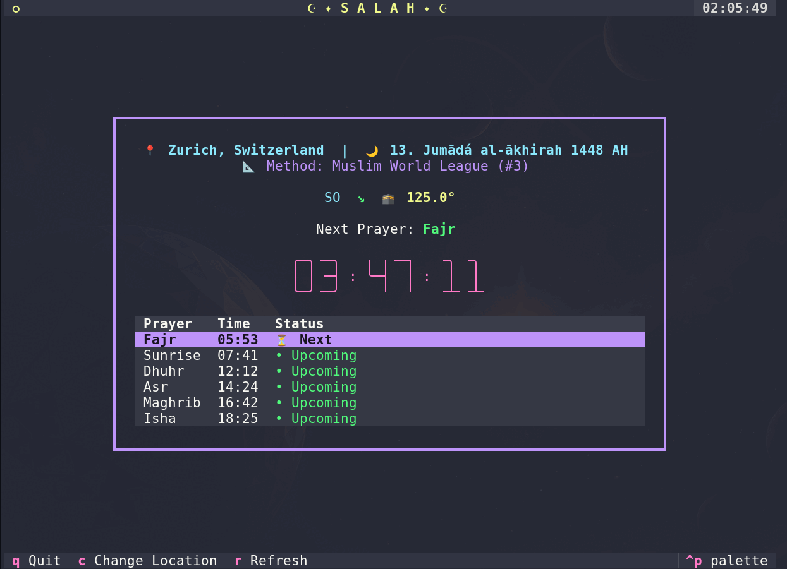

# ☪ Kuran-ı Kerim TUI

<p align="center">
  
</p>
A terminal user interface (TUI) for reading the Holy Quran, built with [Textual](https://textualize.io) and the **Dracula** theme.

## ✨ Key Features

- **Parallel Study View (`v`):** Compare two translations side-by-side verse by verse.
- **100+ Translations (`c`):** Access editions in 40+ languages via the [Al Quran Cloud API](https://alquran.cloud).
- **Direct Navigation (`g` / `/`):** Jump to specific verses (e.g., `2:255`) or filter the 114 Surahs.
- **Bookmarks & Cache (`b`):** Save favorites, auto-resume reading, and cache chapters locally in `~/.config/quran-tui/cache/` for offline access.

## 📦 Installation

```bash
pipx install quran-tui
```

## 🚀 Usage

```bash
quran
```

### Shortcuts

| Key | Action |
| :--- | :--- |
| `v` | Toggle side-by-side comparison |
| `c` | Select translations |
| `g` | Go to Surah or verse |
| `b` | Bookmarks |
| `/` | Filter Surahs |
| `j` / `k` | Scroll down / up |
| `q` | Quit |

## 📄 License

**GNU General Public License v3.0** (GNU GPLv3) **🄯 All Lights returned** [postsonde](https://github.com/postsonde)

---

## ☪ Islamic Terminal Suite (Dracula Theme)

A minimalist suite of Islamic terminal applications built with Python & [Textual](https://textualize.io), styled in the [Dracula](https://draculatheme.com) dark theme.

<p align="center">
  
</p>

| App | Command | Description |
| :--- | :--- | :--- |
| **[salah-tui](https://github.com/postsonde/salah-tui.git)** | `salah` | Islamic prayer times mapping the sun path on the horizon, Hijri date & calculation methods |
| **[hijri-tui](https://github.com/postsonde/hijri-tui.git)** | `hijri` | Native Hijri calendar with lunar phases, Sunnah fasting & holy days |
| **[quran-tui](https://github.com/postsonde/quran-tui.git)** | `quran` | Study the Holy Quran with 100+ translations, side-by-side view & bookmarks |
| **[asma-tui](https://github.com/postsonde/asma-tui.git)** | `asma` | Learn the 99 Names of Allah with flashcards, streak quiz & directory |
